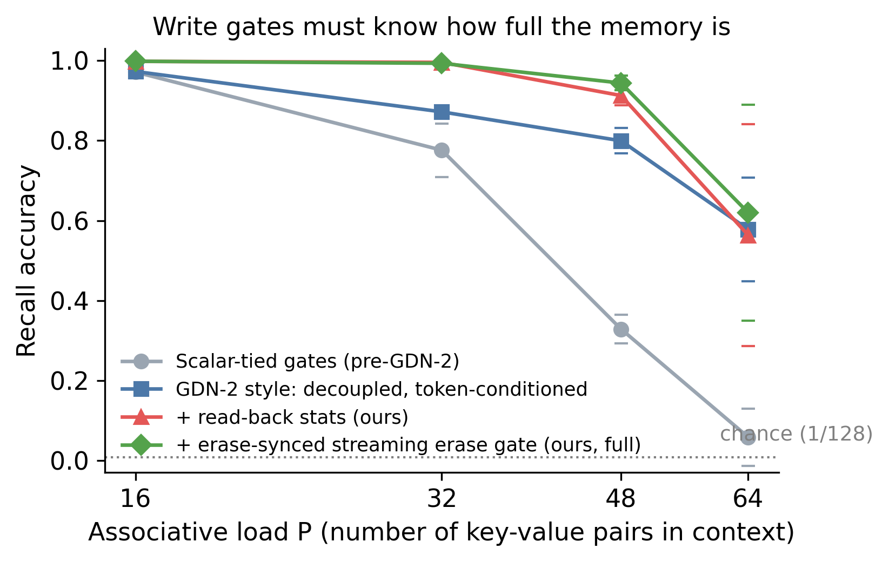
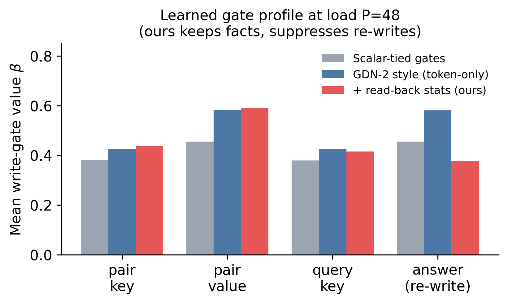
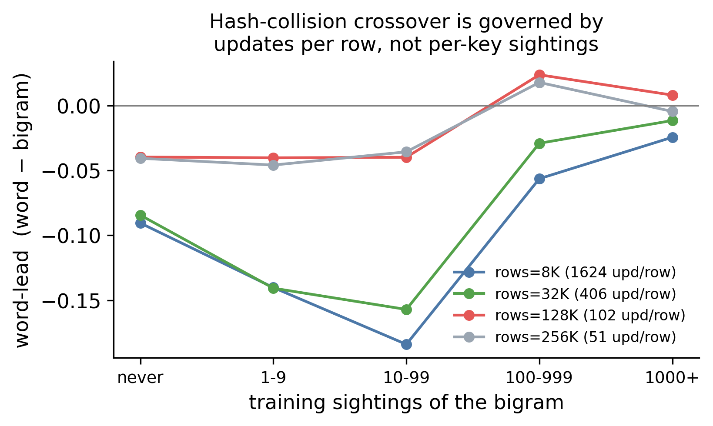
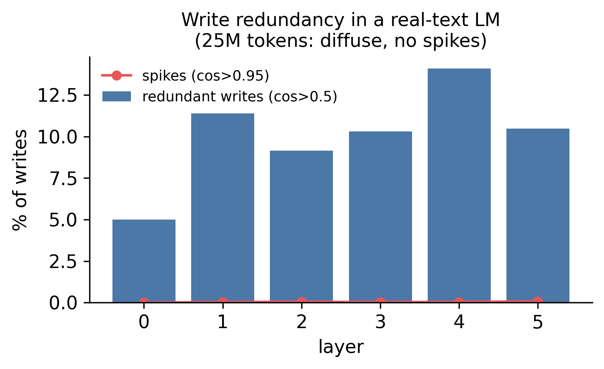

# Load- and Content-Aware Write Gating for Delta-Rule Memory

**Diagnosing and fixing load-blind erase/write gates in linear attention — with a numerically verified testbed, pre-registered protocols, and open raw records.**

Preliminary research by a graduate student. All results below are mechanism-level findings at small scale (1–9M parameters); the compute ask (see **Scaling plan**) is to validate them at 340M / 15–20B tokens under the community's standard retrieval protocol (RULER).

---

## TL;DR

Delta-rule linear attention compresses context into a fixed-size state. Its erase/write gates decide **which** associations to overwrite — but state-of-the-art gates (Gated DeltaNet-2 style) are **conditioned only on the incoming token**: they never see *how full the memory is*, nor *what is already stored under the key being written*.

We show this **load-blindness** is measurable and consequential:

1. **Load — not distance — is the binding constraint.** Tripling the fact–query distance costs 5.4 accuracy points; tripling the associative load costs **53 points** (0.978 → 0.444 at P=64).
2. **Token-conditioned gates cannot express the fix.** At every load we tested, the learned token-conditioned gate writes *new facts* and *redundant re-writes* with the same strength (β = 0.78 vs 0.78 at P=16) — its input cannot distinguish them. The gate profile is structurally invariant across a 4× change in load.
3. **Conditioning the gate on two free read-back statistics fixes it.** `cos(S^pre_t k_t, v_t)` (read-back confidence) and `‖S^pre_t k_t‖/‖v_t‖` (occupancy along the write direction) are by-products of the delta-rule erase path. Adding them to the gate logits costs **+4 scalars per head** and is **bit-identical at initialization**. With this, the gate learns to keep facts (β≈0.7) and suppress re-writes (β≈0.1–0.5), and recall at load P=32 improves from **0.872 → 0.996 (+12.4 points, seed-sd 0.001)** — while remaining at parity at low load.



*Recall vs associative load. Scalar-tied gates collapse first; GDN-2-style decoupled gates delay but do not prevent the collapse; read-back-conditioned gates (ours) stay near-perfect through P=32 and degrade gracefully beyond. Error bars = ±1 sd over 2 seeds.*



*Learned gate values at load P=48 by position class. The token-only gate treats a fresh fact write and a redundant re-write identically; ours separates them.*

---

## What is in this repo

| Path | Content |
|---|---|
| `src/memory_lm.py` | Single-file testbed: exact chunked delta-rule linear attention (gla / delta / gd / gde / gdn2 mixers), all gate variants (scalar-tied, decoupled token-conditioned, erase-synced, read-back-conditioned), word/bigram lookup tables, MQAR + text-LM tasks, write-redundancy census, gate probes |
| `src/verify.py` | **25/25 numerical conformance checks**: chunked fast implementation vs step-by-step recurrence, 5 mixers × 5 gate modes, fp64, max deviation ≤ 2.4e-9 |
| `src/run_e*.py` | Idempotent runners for every experiment below (E1 collision sweep, E2 distance, E2b load probe, E3 budget split, E4 gate load sweep) |
| `src/make_figures.py` | Every figure in this README, generated from the raw records |
| `results/*.jsonl` | **All 45+ raw training records** (one JSON line per run: full args + scores + gate probes) |
| `docs/` | Pre-registered hypotheses & falsification conditions; detailed report; research direction |

Everything is MIT-licensed. No results in this README are hand-copied: `src/make_figures.py` regenerates every figure and `src/analyze.py` regenerates every table from the committed raw records.

---

## The experiments

All experiments use a pre-registered protocol: hypotheses and falsification conditions are written down before runs (see `docs/RESEARCH_PLAN.md`), every arm gets its own learning-rate budget, and headline claims require ≥2 seeds with seed-means (single-seed results are labeled directional).

### E4 — are delta-rule gates load-blind?

Block MQAR, L=256, 1,200 steps, width 64 / 2 layers / 4 heads, 2 seeds per cell. Gates:

| arm | erase | write | condition |
|---|---|---|---|
| `gd` | scalar-tied to β | scalar-tied to β | pre-GDN-2 baseline |
| `gdn2` | channel-wise, learned | channel-wise, learned | token-conditioned only (**GDN-2 style**) |
| `gdn2+stat` | channel-wise | channel-wise | **+ read-back stats in gate logits (ours)** |
| `gdn2+sgkE+stat` | erase-synced streaming gate | channel-wise + stats | ours, full |

| load P | gd | gdn2 | **+stats (ours)** | +erase-synced streaming gate |
|---|---|---|---|---|
| 16 | 0.971 ± .007 | 0.973 ± .011 | **0.998 ± .001** | **0.998 ± .001** |
| 32 | 0.776 ± .067 | 0.872 ± .002 | **0.996 ± .001** | **0.993 ± .004** |
| 48 | **0.329 ± .035** (collapse) | 0.799 | **0.929** | **0.944** |
| 64 | **0.058** (collapse) | 0.578 ± .129 | 0.563 ± .196 | **0.620 ± .271** |

Three readings:

- **The scalar-tied gate collapses first** (P=48: 0.33; P=64: 0.06) — consistent with GDN-2's own motivation for decoupling.
- **Decoupling delays but does not prevent the collapse**: GDN-2-style gates hold 0.80 at P=48 but fall to 0.43–0.67 at P=64, with large seed variance. **At extreme overload, the capacity wall dominates every gate variant** — an honest boundary.
- **Our read-back condition is the best arm at every load**, with the largest gains exactly where the collapse starts (P=32: +12.4 points at seed-sd 0.001; P=48: +10–13 points).

### The mechanism (gate probes)

We instrument the mean write-gate value per position class (new-fact key / new-fact value / query key / answer re-write):


The **token-conditioned gate assigns identical strength to a fresh fact and a redundant re-write** (0.78 vs 0.78 at P=16; the same at P=32/48) — its input, the token's hidden state, cannot distinguish the two cases. The **read-back-conditioned gate separates them** (pair-value ≈ 0.7, re-writes ≈ 0.1–0.5): the read-back confidence `cos(S^pre k, v)` is systematically different between "this value is not yet stored" and "the state just returned this value".

This is a direct measurement of the expressivity gap that GDN-2-style gates cannot close by training alone.

### E2/E2b — what actually limits the state?

| probe | result | reading |
|---|---|---|
| distance: L=64 → 512 (8×) at P=16 | accuracy 0.982 → 0.929 (−5.4 pts) | mild |
| load: P=16 → 64 (4×) at L=256 | accuracy 0.978 → 0.444 (**−53 pts**) | **dominant** |

The fixed-size state is a lossy compressor whose failure is governed by **associative load vs capacity**, not by distance. Any write gate whose policy cannot adapt to load is optimizing the wrong variable — this is the paper-length version of why load-awareness matters.

### E1 — what governs hashed n-gram table crossover? (updates per row)

For the external-memory half of the same budget question: a hashed bigram table's advantage over a per-word table on rare n-grams decays monotonically (−0.180 → −0.036 nats) as the table grows from 8K to 256K rows — i.e. as **updates-per-row falls from 1,624 to 51**. The crossover with the word table lands at ≈100 updates/row. **The governing variable is updates per row, not per-key sightings** — a correction to the standard "seen 100 times" heuristic for collision-pooled tables.



### Write-redundancy census (real text, 25M tokens, 6-layer delta LM)



5.0 / 11.4 / 9.2 / 10.3 / **14.1** / 10.5 % of state writes are redundant (read-back cos > 0.5) per layer — diffuse, rising with depth, and **without spikes** (cos > 0.95 in <0.1% of writes). This quantifies why hard "block redundant writes" oracles transfer poorly to natural text: there is no spike to block, only a diffuse distribution that needs soft, load-aware gating.

---

## Numerical correctness

The chunked (parallel) fast implementation is checked against a step-by-step recurrence for **every mixer × every gate mode** — 25 configurations, fp64, max deviation 2.4e-09:

```
$ python src/verify.py
PASS gla/none ... PASS gdn2/none ... PASS gdn2/sgk ...
ALL PASS
```

A gate paper whose kernel is subtly wrong produces subtly wrong science; this check is cheap and we run it before every experiment batch.

---

## Scaling plan (what we are asking compute for)

The mechanism above is established at ≤9M parameters on synthetic recall and a 13M-token text LM. To test whether it survives contact with the community's standard protocol:

| step | scale | compute | purpose |
|---|---|---|---|
| 1 | 125–180M params, 2B tokens, FineWeb-Edu | ~12 h on one 4090/A100 per run × 8 runs | pilot: does the read-back condition survive real-text pretraining? |
| 2 | **340M params, 15–20B tokens** (the scale of the closest external-memory work) | ~2.5 A100-days per run × 6–8 runs | main result: Wiki/LMB ppl + **RULER S-NIAH-1/2/3 and MK-NIAH-1/2 at 4K/8K/16K** |
| 3 | recurrent-only + hybrid (+SWA) variants | +2 runs | robustness to the deployment-typical hybrid setting |

**Pre-registered prediction**: the read-back-conditioned gate's gain concentrates on **MK-NIAH** (multi-key = high associative load = the regime where our diagnosis says token-conditioned gates fail) and is absent or small on S-NIAH-1 (low load). S-NIAH must not regress.

## Citation

If you use this testbed or build on these findings:

```
@misc{loadaware2026,
  title  = {Load- and Content-Aware Write Gating for Delta-Rule Memory},
  author = {Wu QingYang},
  year   = {2026},
  url    = {https://github.com/Naico-qy/load-aware-write-gating}
}
```

## License

MIT.
